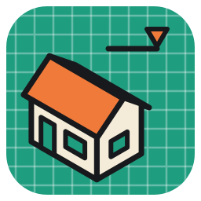
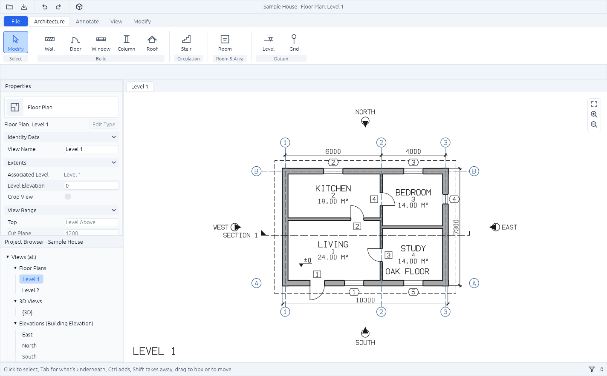
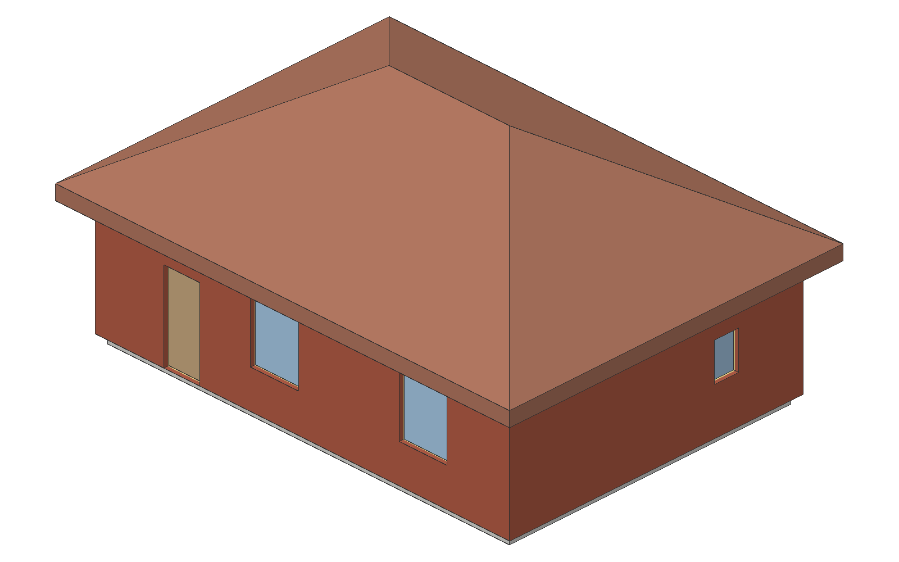
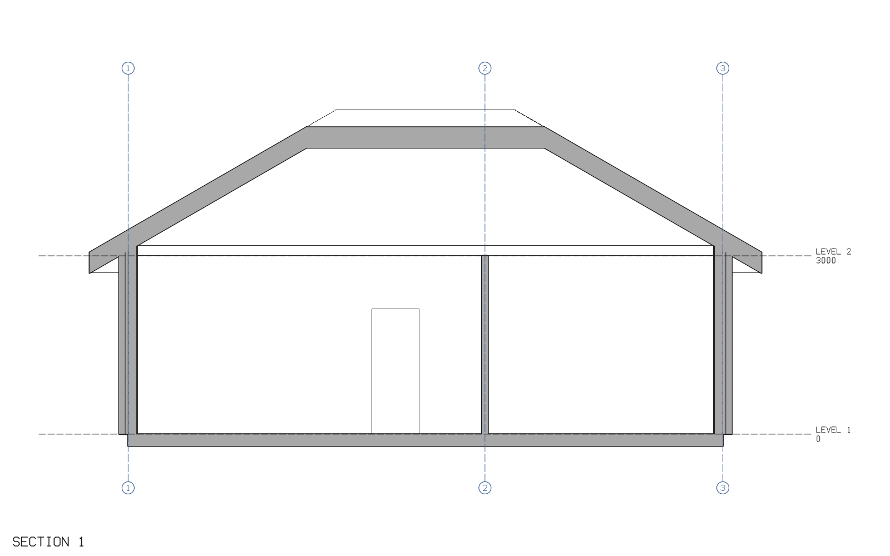
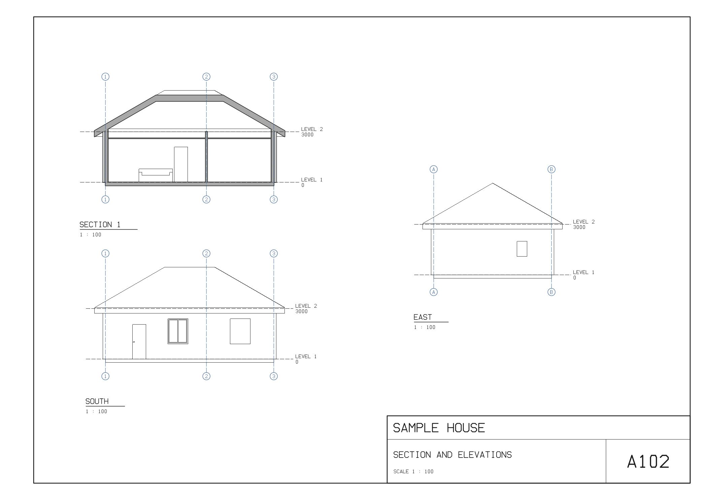
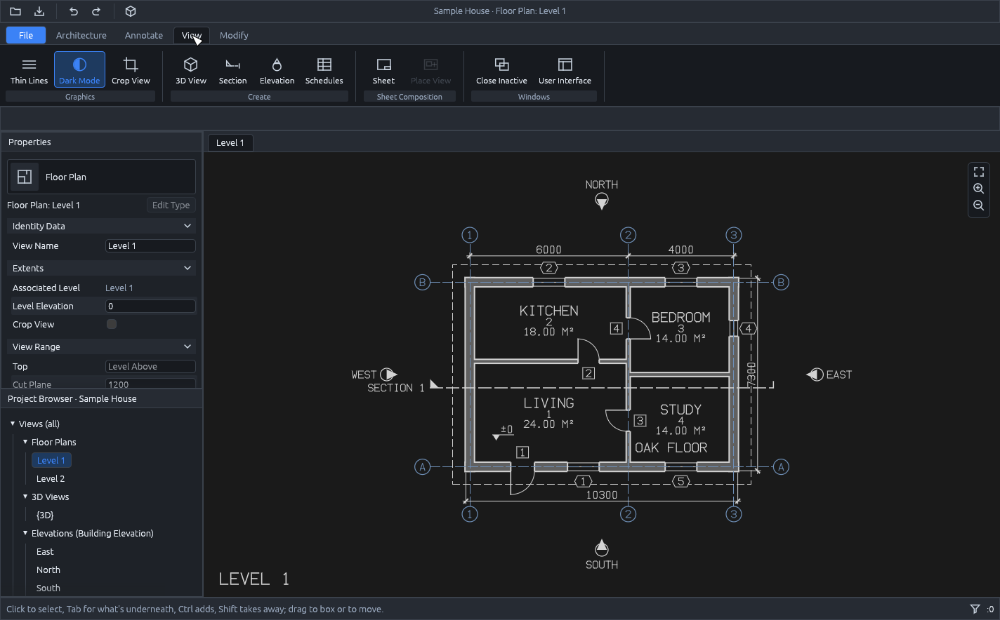
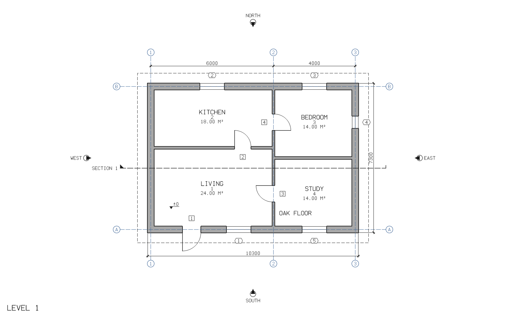
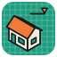

<p align="center">
  
</p>

<h1 align="center">BIMCraft</h1>

<p align="center">
  <b>Building information modeling; an open-source, clean-room take on the Autodesk Revit workflow, rebuilt in pure Rust.</b>
</p>

<p align="center">
  Model a building the way Revit does: levels, walls, doors and windows, floors, rooms, columns, stairs and roofs that
  know about each other. Draw plans, sections, elevations and a 3D view from them, lay them out on sheets, and read and
  write IFC. Every action is a command, so agents can drive it as well as you can.<br>
  <i>By IPedrax.</i>
</p>

<p align="center">
  
  
  
  
  
</p>

<br>

<p align="center">
  
  <br><sub><b>The sample house</b> (<code>cargo run --release -p bimcraft -- --sample</code>): Revit's layout in BIMCraft's own icons and colours, with dimensions, door and window tags, a spot elevation, a note, a section and the four elevation marks, all built from BIMCraft commands.</sub>
</p>

<p align="center">
  <a href="#screenshots">Screenshots</a> ·
  <a href="#why-bimcraft">Why BIMCraft</a> ·
  <a href="#what-works-today">What works today</a> ·
  <a href="#quick-start">Quick start</a> ·
  <a href="#the-desktop-app">The desktop app</a> ·
  <a href="#drive-it-from-agents-mcp-and-the-cli">Agents, MCP and the CLI</a> ·
  <a href="#commands">Commands</a> ·
  <a href="#architecture">Architecture</a> ·
  <a href="#roadmap">Roadmap</a> ·
  <a href="#downloads">Downloads</a> ·
  <a href="#license-and-credits">License and credits</a>
</p>

## Screenshots

<table>
  <tr>
    <td width="50%"></td>
    <td width="50%"></td>
  </tr>
  <tr>
    <td><sub><b>3D view</b>: from the south-east, as Revit's default 3D view looks. Orbit, pan and zoom; click to select.</sub></td>
    <td><sub><b>Section</b>: the cut in poché, the roof along its slope, what lies beyond in hidden line, levels and grids.</sub></td>
  </tr>
  <tr>
    <td width="50%"></td>
    <td width="50%"></td>
  </tr>
  <tr>
    <td><sub><b>Sheets</b>: views placed at a scale under a title block, printed to PDF a page each.</sub></td>
    <td><sub><b>Dark mode</b>: the window and the views go dark; sheets stay white paper.</sub></td>
  </tr>
</table>

## Why BIMCraft

- **The workflow you know.** Revit's ribbon, the green contextual Modify tab, the Options Bar, Properties with the Type
  Selector and Edit Type, the Project Browser, views in tabs, and Revit's shortcuts: WA, DR, WN, RM, CL, DI, TG, MV, CO,
  RO, MM, AL, TR, SL. Click to select, Ctrl adds, Shift takes away, Tab reaches what's underneath.
- **A real building model.** Doors and windows live in their walls, rooms find their boundaries from the walls around
  them, walls joined at a corner stay joined when one moves, dimensions and tags follow what they measure and name, and
  every change is checked against the model's rules and can be undone.
- **Open files.** IFC2x3 and IFC4 come in from Revit and other BIM tools, and IFC4 goes back out, checked with
  IfcOpenShell. Sheets print to PDF; any view saves as PNG, plans as SVG. Revit's own `.rvt` format is closed, so IFC is
  the way in and out.
- **Built for agents.** Every tool, button and field is a command. Agents call any of them with JSON, inspect the model to
  check their work, and render any view to look at it, over MCP or the CLI.
- **Fast and native.** Pure Rust and egui: no Electron, no web view. Developed on Linux; macOS and Windows builds aren't
  tested yet.
- **Free.** MIT OR Apache-2.0, with no account and no subscription.

## What works today

BIMCraft is in early, fast development. Honest status:

| Area | Works today |
|---|---|
| Datums | Levels with elevations; grids that name themselves 1, 2, 3… or A, B, C… |
| Walls | Chains of straight walls on their centre line; wall types by thickness; base level and offset; the top at a level or an unconnected height (by default, up to the next level) |
| Doors, windows | Hosted in walls: place one at a point on the wall (`at`), or by wall and offset; marks number themselves; flip facing and hand; refused when they don't fit their wall or overlap |
| Floors | A boundary you give, or the outline of the walls on the level |
| Columns, stairs, roofs | Columns of rectangular or round types, turned to any angle, from their level up to the next (or a height, or a level); cut in plan, in poché. Straight stairs from a start point toward an end point, in as many risers as keep each at most 180 mm, treads 280 mm deep, up to the next level; in plan, their risers up to the cut line and the rest dashed, and the walk line marked UP (DN from the level above). Roofs on a level, flat over any outline or pitched over a rectangle, hipped or with gable ends; by default over the walls of the level below, 500 mm past their faces, at 30°; in plan, their ridge and hips, and from the level below their edge dashed overhead |
| Rooms | Placed at a point, bounded by the walls around it, and following them when they change; free-standing islands (a shaft) are subtracted; area and perimeter at the wall centre line |
| Types | Wall, floor, door, window, column and roof types; editing one changes every element that uses it |
| Editing | Modify any field, of one element or many in one step; move, copy, rotate and mirror, with the walls joined to them stretching to stay joined and doors and windows going with their walls; trim or extend two walls to a corner; split a wall; delete (a wall takes its doors and windows with it, and they their tags); undo and redo |
| Annotation | Aligned dimensions between parallel references, one segment or a chain: wall faces, centre lines and ends, door and window centres and jambs, grids; angular dimensions between two lines that meet, and radial ones on round columns; all measuring the model as it is, so they follow what they measure (a change that would turn a reference out of parallel with the others is refused). Door and window tags showing their marks, going where their doors and windows go, with or without a leader; tag everything not tagged yet in one go. Text notes in plans, sections, elevations and on sheets, of any size and angle, over several lines, with a leader; spot elevations reading the top of what they stand on in plan (a floor, a roof's slope, a stair's tread), or the height of a point in a section |
| Views | A floor plan per level with Revit's view range: cut at its cut plane (1200 mm up by default), what lies below seen from it down to the bottom, faint beyond it down to the view depth, and roofs overhead up to the top: wall poché with clean joins, door swings, window glass, room tags, grid bubbles, dimensions, door and window tags; PNG and SVG. Sections and elevations along any line: the cut in poché (a roof's along its slope), what lies beyond in hidden line, levels named with their heights, grids; the four building elevations in one go; their marks on every plan; PNG. Crop regions on plans and sections: the view shows only what's inside, grids stopping at its edge with their bubbles. A 3D view, from any angle: walls with their doors and windows cut out, slabs, columns, stairs and roofs, door leaves and glass, shaded, with an edge wherever faces meet; PNG |
| Sheets | ISO A0 to A4, landscape, with a title block (project, sheet name and number, scale); plans, sections, elevations and the 3D view placed on them at a scale and titled, schedules as ruled tables, text notes on the paper, a view on one sheet; PNG, and PDF: one sheet, or every sheet a page |
| Schedules | Rooms, doors, windows, walls, floors and levels; CSV; on sheets |
| IFC import | IFC2x3 and IFC4 files, as Revit and other BIM tools write them: storeys, straight walls with their doors and windows, floors, rooms, columns, grids, single straight stairs, and roofs flat or pitched over a rectangle, each measured from its geometry, whether the file extrudes a profile, writes a Brep or a triangle mesh; walls that nearly meet are joined; a model at map coordinates is moved near the origin; what can't come in is listed, with why |
| Files | `.bimcraft` projects (JSON); IFC4 export with storeys, swept-solid walls, slabs, spaces, columns and stairs, roofs as closed shells of flat faces, and openings that cut the walls and hold the doors and windows (dimensions, tags, notes and spot elevations belong to views, and stay out of it) |
| Agents | MCP server, scripts, and every command callable with JSON |
| Desktop | Revit's layout: ribbon tabs with a contextual Modify tab, the Options Bar, Properties with the Type Selector and Type Properties, the Project Browser and views in tabs; a plan per level that pans and zooms, sections and elevations, a 3D view that orbits, and sheets; tools for walls, doors, windows, columns, roofs, stairs, rooms, levels, grids, dimensions (aligned, angular, radial), spot elevations, text, tags, sections and elevations; Crop View with grips to drag a crop region's edges, and the view range in Properties; Revit's selection (click, Ctrl, Shift, Tab, window and crossing boxes); dragging and the Modify panel (Align, Offset, Mirror, Split, Move, Copy, Rotate, Trim/Extend to Corner); typed lengths and temporary dimensions; undo and redo; open, save and export; a light and a dark theme |

The IFC4 export is checked with [IfcOpenShell](https://ifcopenshell.org) 0.9: the sample house has no schema or EXPRESS rule
errors, every element builds its geometry, and the walls' volumes (with the openings cut out) and the roof's match a hand
calculation. Import is checked against it too: the sample comes back the same from IFC, element by element, also with its
geometry turned into triangle meshes by IfcOpenShell, and a building IfcOpenShell's API writes comes in whole.

## Quick start

The engine and the CLI need Rust 1.90 or later; the desktop app needs 1.95 (egui 0.36).

```sh
git clone https://github.com/IPedrax/bimcraft
cd bimcraft
cargo run --release -p bimcraft -- --sample       # opens the sample house
```

Without a window:

```sh
cargo build --release
./target/release/bimcraft-cli run --sample --save house.bimcraft --save house.ifc --save plan.png
```

That builds the sample house and saves the project, an IFC4 file and the Level 1 plan:

<p align="center">
  
</p>

`--cmd 'render {"view": "{3D}", "path": "house-3d.png"}'` adds the 3D view (`azimuth` and `elevation` turn it);
`render {"view": "Section 1"}` draws the sample's section, `South` (or `North`, `East`, `West`) one of its elevations, and
`render {"view": "A102"}` one of its sheets. `--save sheets.pdf` prints every sheet, a page each.

A script is one command per line, `id {json params}`, with lengths in millimetres:

```text
wall {"points": [[0,0],[8000,0],[8000,6000],[0,6000]], "closed": true, "type": "Exterior - 300mm"}
door {"at": [2000, 0]}
window {"at": [8000, 3000]}
room {"point": [4000, 3000], "name": "Living"}
floor {}
roof {}
```

```sh
bimcraft-cli run --script house.txt --save house.ifc
bimcraft-cli convert building.ifc building.bimcraft   # an IFC file from Revit or any BIM tool, as a project
bimcraft-cli info house.bimcraft                      # levels, counts, types and warnings
bimcraft-cli convert house.bimcraft plan.svg
bimcraft-cli commands                                 # every command and its parameters
```

## The desktop app

`bimcraft [FILE] [--sample]` opens a `.bimcraft` project, imports an `.ifc` file, or starts on the sample house. The layout
is Revit's, so it should feel familiar: the Quick Access Toolbar; the ribbon's File, Architecture, Annotate, View and Modify
tabs, with a green contextual tab (Modify | Place Wall, Modify | Walls) for the tool or the selection; the Options Bar;
Properties over the Project Browser; views in tabs with a navigation bar; and the tool's prompt in the status bar. The
icons and colours are BIMCraft's own, in a light theme or a dark one: BIMCraft starts in your system's, and View > Dark Mode
switches.

| To | Do |
|---|---|
| Draw walls | Wall (WA), click points; Enter builds the chain, Esc drops it, a click back on its start closes it. Ends snap to wall ends and centre lines; Shift keeps a segment square. The Options Bar sets the height (up to a level, or unconnected) and Chain |
| Place doors, windows | Door (DR) or Window (WN), click a wall; the Type Selector at the top of Properties picks the type |
| Place rooms | Room (RM), click inside walls; the outline and area show before you click, and the tag's area follows the walls |
| Place columns | Column (CL), click where it stands; it snaps to wall ends and centre lines. The Options Bar sets how high it goes (up to a level, or unconnected), the Type Selector rectangular or round |
| Add stairs | Stair: click where it starts (the middle of its first riser), then which way it climbs. It goes up to the level above in risers of at most 180 mm; the Options Bar sets its width, Properties its riser, tread and top |
| Roof the building | Roof, in a plan: click inside the walls, and a roof goes on the level above, over their outline and past their faces; its hips show before you click. The Options Bar sets the slope (0° for a flat roof), the overhang and gable ends |
| Add levels, grids | Level (LL) takes an elevation in the Options Bar; Grid (GR) takes two clicks |
| Select | Click; Ctrl adds, Shift takes away, Tab reaches what's underneath (the wall under a door). Drag across empty floor for a box: left to right takes what's wholly inside, right to left what it crosses too |
| Edit, delete | Properties edits the parameters of everything selected, in one step, grouped as Revit groups them; the Type Selector changes the type; Delete removes the selection |
| Move, copy | Drag a selected element, or Move (MV) and Copy (CO): click a base point, then where it goes. Walls joined to a moved wall stretch to stay joined, so room areas follow; doors and windows slide along their walls. Constrain keeps the move square; Multiple goes on copying |
| Rotate, mirror | Rotate (RO) turns the selection about its middle: click the angle's start, then its end, or type an angle in the Options Bar; Place Centre moves the centre. Mirror Pick Axis (MM) mirrors across a wall or grid you pick, Mirror Draw Axis (DM) across a line you click; Copy is on, as in Revit |
| Align, trim, split, offset | Align (AL): pick a reference line (a grid, a wall's face or centre line), then the wall to line up with it. Trim/Extend to Corner (TR): pick two walls on the parts to keep. Split Element (SL): click a wall where to cut it. Offset (OF): point to a wall, and a copy goes to the cursor's side at the Options Bar's distance |
| Dimension, tag | Annotate > Aligned (DI): pick parallel references, each the line nearest the cursor (a wall's face, centre line or end, a door's or window's centre or jamb, a grid), then click away from them where the dimension line goes; more picks make a chain. Angular: pick two lines that meet, then click where the arc goes; the angle on that side. Radial: pick a round column, then click where the radius goes. Annotate > Tag by Category (TG): click a door or window to tag it with its mark, with a leader when the Options Bar says so; Tag All tags the rest of the view. Drag a dimension or a tag to move it |
| Spot elevations, text | Annotate > Spot Elevation (EL): click a floor, a roof, a stair or a wall in plan, and it reads the height of its top there, following it; in a section, click a point to mark its height. Annotate > Text (TX): type the note in the Options Bar (`\n` breaks a line), then click its top left corner, in a plan, a section or on a sheet; Properties sets its size and angle |
| Crop, view range | View > Crop View crops a plan or a section to what it shows; drag the grips at its edges' middles to move them (a section's sides move its line). Off shows it all again. Properties of a plan holds its View Range: Top (clear it for the level above), Cut Plane, Bottom and View Depth, in mm above the level |
| Lengths | While a tool waits for its next point, type a length and press Enter: it goes that far toward the cursor. A selected wall shows its length as a temporary dimension; click the number to type a new one |
| Edit types | Edit Type opens Type Properties: change the type everywhere it's used, or Duplicate it into a new one |
| Views | The Project Browser opens plans, elevations, sections, the 3D view and schedules in tabs; View > Close Inactive closes the others |
| Lay out sheets | View > Sheet makes one (A101, A102…); on it, Place View puts a view that's on no sheet yet: a plan, a section or an elevation at 1 : 100, the 3D view as it's turned on screen, or a schedule. Drag a view or a note to move it, set its scale in Properties, double-click it to open it. File > Export > Sheets as PDF prints them all |
| Cut a section, add an elevation | View > Section: click its start and end; it looks to the left of the line, so drawn west to east it looks north. View > Elevation: click beside the building, and it looks at that side. Open them from the browser, or double-click their marks in a plan; in them, click to select what they cut or see |
| Look in 3D | The cube on the Quick Access Toolbar (or View > 3D View, or {3D} in the browser) opens the 3D view. Shift and the middle button orbit, as in Revit, and so does a drag; the middle button pans, the wheel zooms; Home in the navigation bar goes back to the south-east view. Click to select, as in plan |
| Move around | The wheel zooms at the cursor, the middle button pans, the navigation bar or ZF zooms to fit; TL toggles Thin Lines |
| Go dark | View > Dark Mode: the window, plans, sections and the 3D view go dark; sheets stay white paper |
| Undo, redo | Ctrl+Z, Ctrl+Y, or the Quick Access Toolbar |
| Files | Ctrl+N, Ctrl+O, Ctrl+S; Open takes IFC files too, and a note says what came in and what was left out; the File tab saves, and exports IFC, the sheets as PDF, and the view on screen as PNG (or a plan as SVG) |

Each of these runs a command, so what you do in the window is checked, undone and saved exactly as from the CLI or an agent.

## Drive it from agents, MCP and the CLI

`bimcraft-cli mcp` serves the [Model Context Protocol](https://modelcontextprotocol.io) over stdio, on a model of its own.
Add it to Claude Code:

```sh
claude mcp add bimcraft -- /path/to/bimcraft-cli mcp
```

or to any MCP client's configuration:

```json
{ "mcpServers": { "bimcraft": { "command": "/path/to/bimcraft-cli", "args": ["mcp"] } } }
```

| Tool | What it does |
|---|---|
| `execute {command, params}` | Any command with JSON parameters |
| `script {text}` | Several commands, one per line |
| `list_commands {filter?}` | The catalog, with parameters and shortcuts |
| `inspect_model` | Levels, counts, types, warnings and undo history |
| `query_elements {category?, level?}` | Elements with derived values: wall length and height, room area, door position |
| `schedule {category}` | Columns and rows |
| `render {view?, width?, height?, azimuth?, elevation?}` | A level's floor plan, a section or elevation by name, a sheet by number, or with `view: "{3D}"` the 3D view, as a PNG the agent can look at |
| `new_model`, `open`, `save` | Projects; `open` imports `.ifc` files, `save` to `.ifc`, `.svg` or `.png` exports |

A command that fails comes back as a tool error saying what to fix (`door: no wall at [4000, 3000] on Level 1`), and it
changes nothing.

## Commands

| Command | Shortcut | Parameters |
|---|---|---|
| `wall` | WA | `points`, `closed?`, `type?`, `level?`, `top_level?`, `height?`, `base_offset?` |
| `door` | DR | `at`, or `wall` and `offset?`; `type?`, `mark?`, `flip_facing?`, `flip_hand?` |
| `window` | WN | as `door`, plus `sill?` |
| `floor` | | `boundary?`, `level?`, `type?` |
| `room` | RM | `point`, `name?`, `number?`, `level?` |
| `column` | CL | `at`, `type?`, `angle?`, `level?`, `top_level?`, `height?`, `base_offset?` |
| `stair` | | `start`, `end?` or `angle?` (the way it climbs), `level?`, `top_level?`, `height?`, `width?`, `riser?` (the most each riser may rise), `tread?` |
| `roof` | | `level?` (the one above the lowest), `boundary?` (else the walls of the level below), `overhang?`, `slope?` (0 is flat), `gable?`, `type?` |
| `dimension` | DI | `refs` (each `{id, face?}`: a wall's `centre`, `left` or `right` face, `start` or `end`; a door's or window's `centre`, or its jamb at the `start` or `end` side; a grid's line; or a point on one), `at`, `level?`, `kind?` (`aligned`, `angular` between two lines that meet, `radial` on a round column) |
| `tag` | TG | `ids?` (without them, every door and window on the level not tagged yet), `level?`, `offset?`, `leader?` |
| `text` | TX | `text`, `at` (its top left), `view?` (a level's plan by default; a section, an elevation, or a sheet by number), `size?` (mm on paper, 2.5), `angle?`, `leader?` |
| `spot` | EL | `at`, `view?`, `host?`: in a plan, the top of what stands there; in a section or an elevation, the point's height |
| `section` | | `start`, `end` (it looks to the left of the line), `depth?`, `name?` |
| `elevation` | | `facing?` (north, south, east or west: the side it shows), `at?`, or `start` and `end`; none of them: the four building elevations |
| `sheet` | | `number?` (A101, A102… by default), `name?`, `size?` (A0 to A4; A3 by default) |
| `place` | | `sheet` (its number), `view` (a level's, section's, elevation's, schedule's or 3D view's name: Room Schedule, `{3D}`…), `at?` (mm on the paper), `scale?` (100 for 1 : 100), `azimuth?` and `elevation?` for the 3D view |
| `crop` | | `view`, `region?` (two corners: plan mm, or along a section and up), or `null` to uncrop; none: to what the view shows |
| `level` | LL | `elevation`, `name?` |
| `grid` | GR | `start`, `end`, `name?` |
| `type` | | `category`, `name`, and its sizes: creates the type, or edits it everywhere it's used |
| `modify` | | `id` (or `ids`, several in one step) and the fields to change; into a field that is an object, such as a level's `view_range` (`top`, `cut`, `bottom`, `depth`), they merge |
| `move` | MV | `ids`, `by`; `end` to move one end of a wall |
| `copy` | CO | `ids`, `by` |
| `rotate` | RO | `ids`, `about`, `angle` in degrees, `copy?` |
| `mirror` | MM, DM | `ids`, `axis` (two points), `copy?` |
| `corner` | TR | two wall `ids`, `keep?` (a point on the part of each to keep) |
| `split` | SL | `id`, `at` |
| `delete` | DE | `ids` |
| `undo`, `redo` | | |
| `inspect`, `elements`, `schedule`, `render` | | read the model |
| `new`, `open`, `save` | | projects; `open` imports IFC, listing what it left out; `save` exports by extension |

A `level` can be given by name or id; without one, commands use the lowest level. `render {view}` draws a plan, a section or
an elevation by name, a sheet by number (a path ending .pdf prints it), or with `{3D}` (and `azimuth?`, `elevation?`) the 3D
view. `save` to a .pdf prints every sheet, a page each.

## Architecture

```text
crates/core            bimcraft-core: everything but the front ends; no UI
  geom.rs              points, rings, and the planar faces rooms are found from
  model.rs             the building model, and the rules checked after every command
  engine.rs            the session: commands, undo and redo, scripts
  commands.rs          the command set
  render.rs, font.rs   plans, sections and elevations as display lists drawn to SVG, PNG or a canvas, cropped to their crop
                       regions, in our own stroke lettering
  view3d.rs            the 3D view: the model as solids, drawn with a depth buffer, shaded and edged; picking
  sheet.rs, pdf.rs     sheets: the title block, the views on them at their scales, schedules as tables, notes; PDF
  schedule.rs, ifc.rs  schedules and CSV; IFC4 export
  step.rs, import.rs   ISO 10303-21 files read; IFC import, every element measured from its geometry
crates/ui-egui         bimcraft-ui-egui: the desktop front end, a thin shell over the session
  lib.rs               the window: Quick Access Toolbar, ribbon tabs, Options Bar, browser, view tabs, status bar, files
  canvas.rs            the plan: pan, zoom, the navigation bar, picking, the tools and their previews
  orbit.rs             the 3D view: orbit, pan, zoom, picking
  section.rs           sections and elevations: their picture and drawing, pan, zoom, picking
  paper.rs             sheets: their drawing at paper density, scaled as they zoom; views picked, dragged, opened
  properties.rs        Properties: the Type Selector, parameters through `modify`, Type Properties through `type`
  style.rs             a light and a dark palette, spacing, and the icons, drawn in code
apps/bimcraft          the desktop app
apps/bimcraft-cli      run, info, convert, commands, and the MCP server
```

The rules come from CADCraft. Everything is a command, and the desktop, the CLI, scripts and MCP all reach the same ones.
Production code never panics: `unwrap`, `expect` and `panic!` are lint errors, `unsafe` is forbidden, every parameter is
treated as hostile, and a command that fails or panics leaves the model as it was. The core knows nothing of a UI; the egui
front end only reads the model and runs commands, so another front end can replace it. The canvas draws the same display list
the PNG and SVG exports do, and picks elements from it. Agent instructions are in [CLAUDE.md](CLAUDE.md).

## Roadmap

Done: views and notes (view ranges, crop regions, text notes, spot elevations, angular and radial dimensions and dimensions to
wall ends and openings, schedules and the 3D view on sheets). Next, in order: lengths in metres or in feet and inches as well
as millimetres; a Portuguese translation; then real walls (compound types with layers, joins at any angle, curved walls,
walls attached to roofs and floors, other location lines); sloped floors, ceilings and shaft openings; stairs of several
flights with landings, railings and ramps; roofs over any footprint (hips over L-shaped plans), extrusion roofs and dormers;
families, BIMCraft's own parametric components (never Autodesk's `.rfa`); project parameters and schedules with chosen fields,
filters, sorting and formulas; visibility and graphics (overrides, filters, view templates, phases, design options); locked
and equal dimensions, arrays and groups; materials, hatch patterns, perspective views and a section box; DWG and DXF, more of
IFC, and gbXML; structure, then MEP; site and massing; several people editing one model; and packaging for macOS and Linux,
signed installers and auto-update. Revit's own `.rvt` format is closed and undocumented, so BIMCraft won't read it itself;
IFC is the way in and out, and `.rvt` files will come in through Autodesk's own converter.

## Downloads

### Windows

| Build | Installer |
|---|---|
| x64 (64-bit Intel/AMD) | `bimcraft-<ver>-windows-x64.msi` |

The installer puts BIMCraft and `bimcraft-cli` in Program Files for every user, adds BIMCraft to the Start menu, and opens
`.bimcraft` projects in it; a newer version upgrades an older one. For a silent install with a desktop shortcut too:
`msiexec /i bimcraft-<ver>-windows-x64.msi /qn DESKTOPSHORTCUT=1`. It isn't code-signed yet, so Windows SmartScreen asks
before it runs: More info, then Run anyway.

Versions are published on the [releases page](https://github.com/IPedrax/bimcraft/releases) as they're tagged. Between
releases, the Release workflow (Actions > Release > Run workflow) builds the installer for any commit, as that run's
artifact. On Linux and macOS, build from source: see [Quick start](#quick-start).

## License and credits

BIMCraft is dual-licensed under [MIT](LICENSE-MIT) or [Apache-2.0](LICENSE-APACHE), at your option.
Copyright (c) 2026 IPedrax and the BIMCraft contributors.

BIMCraft's logo, its icons, its stroke lettering and its sample house are original work, drawn or built in code. Its
architecture, its rules and its MCP design follow [CADCraft](https://github.com/storytold/cadcraft) (MIT OR Apache-2.0) by
the ArtCraft team, as its logo follows CADCraft's style.

<sub>Autodesk and Revit are trademarks or registered trademarks of Autodesk, Inc. in the United States and/or other countries. BIMCraft is an independent, open-source project and is not affiliated with, sponsored by or endorsed by Autodesk, Inc.; these names are used only to describe the workflow it follows. IFC is an open standard of buildingSMART International, published as ISO 16739.</sub>

<p align="center">
  <br>
  <sub>Made by IPedrax, in pure Rust.</sub>
</p>
